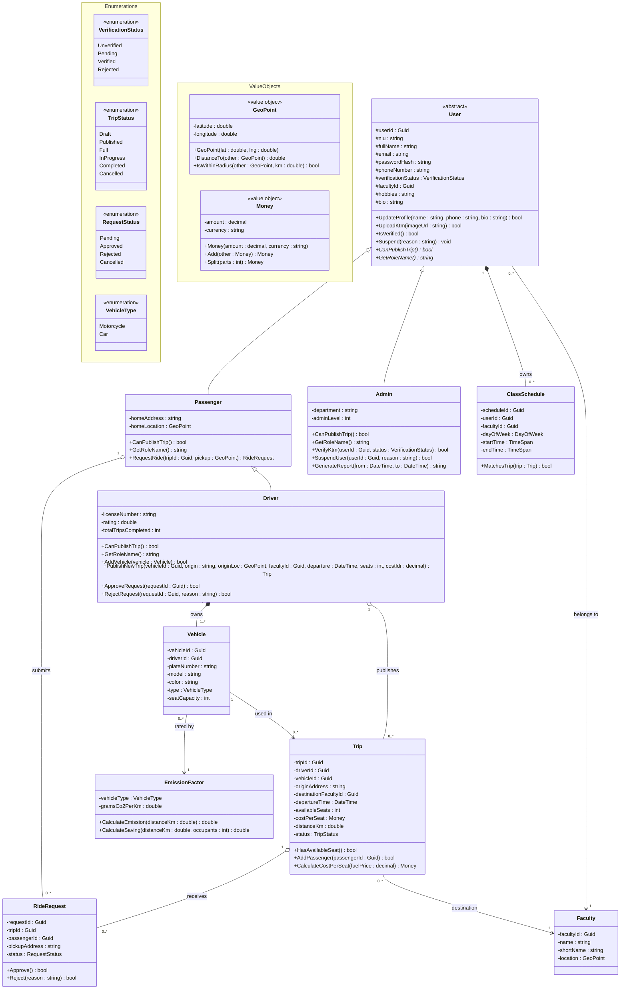

# BARENGIN

**Turn empty campus commuter seats into shared rides matched by class schedule.** BarengIn is a desktop carpooling and emissions-tracking app for Universitas Gadjah Mada (UGM) students. It connects drivers who already commute to campus with passengers heading to the same faculty at the same time.

Solo student commutes clog campus gates, raise daily fuel costs, and increase transport emissions. Commercial ride-hailing is too expensive for daily lectures, while informal chat groups lack student ID checks and seat locks. BarengIn fixes this: *"Verified students, matched by schedule, with every saved kilogram of $\text{CO}_2$ counted."*

Built on .NET 9, Avalonia UI, Neon Cloud PostgreSQL, and OpenStreetMap (Nominatim + OSRM) by four students from Universitas Gadjah Mada.

> Junior Project (Object-Oriented Programming & Databases) · Group 5 · DTETI, Faculty of Engineering, Universitas Gadjah Mada (UGM).

## The three pillars

1. **Schedule and faculty matching.** Trips link to 35 UGM faculties and campus landmarks plus class start times, so drivers only pick up peers along their existing route.
2. **Verified student identity (KTM).** Every user registers with a UGM Student ID (NIM) and uploads a student card (KTM) for admin review. Drivers check a passenger's hobbies and bio before approving a seat.
3. **Measurable $\text{CO}_2$ savings.** OpenStreetMap Nominatim and OSRM calculate road distance, ETA, and avoided $\text{CO}_2$ (`0.12 kg/km`) on every route. The Admin Dashboard tracks campus-wide savings and tree equivalents.

**Guardrails.** Seat approvals use PostgreSQL row locks (`SELECT ... FOR UPDATE`) to prevent overbooking. Only declared admin accounts can enter the Admin role. Passwords use salted BCrypt hashes. If the database or API is offline, the app falls back to in-memory mode without crashing.

## Live & submission artifacts

| | |
| :--- | :--- |
| **Windows x64 self-contained `.exe`** | [`BarengIn-MVP-win-x64.zip`](https://github.com/altafparves/BarengIn/releases/tag/v0.1.0-mvp) (`dist/BarengIn-MVP-win-x64.zip`) |
| **Cloud PostgreSQL database** | Neon Serverless PostgreSQL (`BarengIn` / `spring-flower-98622269`, `production` branch) |
| **Database schema & demo seed** | [`docs/database/schema.sql`](docs/database/schema.sql) · [`docs/database/seed-demo.sql`](docs/database/seed-demo.sql) |
| **Three-minute demo video** | *Link to be added upon final video upload* |
| **Project presentation (PPT)** | *Link to be added upon final presentation upload* |
| **Architecture & database diagrams** | [15-Table ERD](docs/diagrams/BarengIn%20ERD.png) · [Class Diagram](#oop-class-design) |
| **Black Box test report (32 cases)** | [`docs/module-10/BLACK_BOX_TESTING.md`](docs/module-10/BLACK_BOX_TESTING.md) |

## Built for Junior Project

| We built | We did not build (used as is) |
| :--- | :--- |
| Domain entities & value objects (`User`, `Passenger`, `Driver`, `Admin`, `Trip`, `RideRequest`, `Vehicle`, `ClassSchedule`, `Faculty`, `EmissionFactor`, `GeoPoint`, `Money`) in [`src/BarengIn.Domain/`](src/BarengIn.Domain/) | .NET 9 SDK and C# 13 runtime |
| 15-table PostgreSQL schema, 10 enum types, 18 indexes, and demo seed in [`docs/database/`](docs/database/) | Neon Serverless PostgreSQL and `Npgsql` driver |
| Persistence repositories (`UserRepository`, `RideRepository`, `Database`) in [`src/BarengIn.Infrastructure/Persistence/`](src/BarengIn.Infrastructure/Persistence/) | `BCrypt.Net-Next` hashing library |
| OpenStreetMap geocoding, Yogyakarta autocomplete, and OSRM route/$\text{CO}_2$ client in [`src/BarengIn.Infrastructure/Services/RouteApiService.cs`](src/BarengIn.Infrastructure/Services/RouteApiService.cs) | OpenStreetMap Nominatim and OSRM public REST APIs |
| All 6 desktop screens (Login, Register, Passenger Home, Driver, Profile, Admin) in [`src/BarengIn.Desktop/Views/`](src/BarengIn.Desktop/Views/) | Avalonia UI 11/12 cross-platform desktop framework |
| 81 automated xUnit + headless UI tests and 32 Black Box test cases in [`tests/`](tests/) | xUnit and `Avalonia.Headless.XUnit` |

## Try it (for evaluators)

**Option 1: Submission `.exe` with live Neon cloud database (Windows 10/11, zero setup).**

1. Extract `BarengIn-MVP-win-x64.zip` into a folder.
2. Double-click **`BarengIn.Desktop.exe`** (if Windows SmartScreen prompts, click **More info** -> **Run anyway**).
3. The bundled `appsettings.json` connects automatically to our live Neon database. Log in with any demo account below.

**Option 2: Offline sandbox mode (no network required).**

Set `Password=PASSWORDHERE` in `appsettings.json` (or disconnect from Wi-Fi) and run `BarengIn.Desktop.exe`. The app switches automatically to in-memory sample data.

### Demo accounts (pre-seeded in cloud database)

| Role | Login Identifier (Email / NIM) | Password | Pre-seeded state |
| :--- | :--- | :--- | :--- |
| **Admin** | `admin@ugm.ac.id` | `admin123` | Super Admin access to KTM queue, user suspension, $\text{CO}_2$ leaderboard, and sustainability reports |
| **Driver 1 (Satrio)** | `satrio.driver@mail.ugm.ac.id` (or `24/510001/TK/58001`) | `demo123` | `KTM verified`, Red Mazda 6 (`AB 1421 MZ`), 2 scheduled trips to `Engineering (FT)`, 2 pending requests |
| **Driver 2 (Nalen)** | `nalen.driver@mail.ugm.ac.id` (or `24/510002/EK/58002`) | `demo123` | `KTM verified`, Toyota Fortuner (`AB 1988 FT`), scheduled trip from `Seturan` to `Economics and Business (FEB)` |
| **Passenger 1 (Vino)** | `vino.pax@mail.ugm.ac.id` (or `24/520001/TK/59001`) | `demo123` | `KTM verified`, `Engineering (FT)` student commuting from `Pogung Dalangan` |
| **Passenger 2 (Farhan)** | `farhan.pending@mail.ugm.ac.id` (or `24/520002/TK/59002`) | `demo123` | `KTM pending`, `Engineering (FT)` student waiting for Admin KTM verification |

## Who it is for

| | Solo private vehicle | Commercial ride-hailing | Informal chat groups | BARENGIN |
| :--- | :--- | :--- | :--- | :--- |
| **Identity check** | N/A | Public drivers | Unverified links | UGM NIM + Admin KTM verification |
| **Matching logic** | None | On-demand dispatch | Manual scrolling | Destination faculty + class start time |
| **Cost per trip** | Full fuel + parking | Surge pricing | Negotiated by chat | Fixed, driver-set cost per seat (e.g. Rp 5.000) |
| **Social context** | Alone | Stranger | Phone number only | Student faculty, hobbies, and short bio |
| **Carbon visibility** | None | None | None | OSRM route $\text{CO}_2$ estimate + campus leaderboard |

## Tech stack

| Layer | Technology | Why we chose it |
| :--- | :--- | :--- |
| **Runtime** | C# 13 on .NET 9 | Static typing, clean OOP primitives, and single-file cross-compilation. |
| **Desktop UI** | Avalonia UI 11/12 | **Developed on macOS (MacBook), compiled to Windows `.exe`.** WinForms/WPF cannot run on macOS; Avalonia runs natively on macOS and cross-compiles to a self-contained `win-x64` `.exe`. |
| **Architecture** | Layered DDD (`Domain`, `Infrastructure`, `Desktop`) | `BarengIn.Domain` has zero external dependencies ([ADR-0001](docs/decisions/0001-domain-layer-infrastructure-boundary.md)). |
| **Cloud Database** | Neon Serverless PostgreSQL + `Npgsql` 10.0.3 | Online cloud Postgres (`BarengIn` project, `production` branch) with pooled connections, `FOR UPDATE` seat locks, and instant wake-up. |
| **Routing API** | OpenStreetMap Nominatim + OSRM | Key-less HTTPS APIs for Yogyakarta place autocomplete, driving distance, ETA, and $\text{CO}_2$ estimates. |
| **Testing** | xUnit + `Avalonia.Headless.XUnit` | 81 automated unit, DB, API, and headless UI tests + 32 Black Box test cases. |

## How it works

```
 Student / Admin (Windows .exe or macOS Desktop)
       │  NIM / Email, schedules, ride requests, KTM reviews
       ▼
 ┌──────────────────────────────┐      ┌───────────────────────────────────┐
 │  BarengIn.Desktop            │─────▶│  OpenStreetMap HTTPS REST APIs    │
 │  Avalonia UI (6 Screens)     │      │  Nominatim Geocode · OSRM Route   │
 └──────────────┬───────────────┘      └───────────────────────────────────┘
                │ calls
                ▼
 ┌──────────────────────────────┐      ┌───────────────────────────────────┐
 │  BarengIn.Domain             │      │  BarengIn.Infrastructure          │
 │  User <|-- Passenger         │◀────▶│  UserRepository · RideRepository  │
 │  Passenger <|-- Driver       │      │  RouteApiService · Database.cs    │
 │  User <|-- Admin             │      └─────────────────┬─────────────────┘
 └──────────────────────────────┘                        │ Npgsql TLS (Pooled)
                                                         ▼
                                       ┌───────────────────────────────────┐
                                       │  Neon Cloud PostgreSQL (BarengIn) │
                                       │  15 tables · 10 enums · 18 idx ·  │
                                       │  FOR UPDATE seat transactions     │
                                       └───────────────────────────────────┘
```

1. **Register & upload KTM.** Students register with their NIM, faculty, role, and KTM image (`verification_status = 'pending'`).
2. **Polymorphic login.** `UserRepository.Authenticate` checks the BCrypt hash, enforces the admin allowlist, and returns `Passenger`, `Driver`, or `Admin`.
3. **Post trip & check route.** Drivers pick an origin and faculty; `RouteApiService` queries Nominatim and OSRM for road distance, ETA, and $\text{CO}_2$ saved, and `RideRepository.InsertRide` saves the trip to Neon.
4. **Search & request ride.** Passengers use Yogyakarta pickup autocomplete, view driver hobbies and bio, and submit a seat request.
5. **Approve seat atomically.** `RideRepository.UpdateRequestStatus` locks the ride row (`FOR UPDATE`), decrements `available_seats`, and marks the request `accepted`.
6. **Verify KTM & report $\text{CO}_2$.** Admins verify or reject pending KTMs, suspend users, and generate 30-day sustainability reports.

## Core domain calculations & $\text{CO}_2$ savings model

Every shared ride removes a solo commuter vehicle from campus gates because the driver is already travelling to campus for their own class.

| Calculation | Formula / Logic | Code location |
| :--- | :--- | :--- |
| **Domain $\text{CO}_2$ avoided** | $\text{CO}_2\text{ Saved} = (\text{occupants} - 1) \times d_{\text{km}} \times \text{EmissionRate}_{\text{g/km}}$ | [`EmissionFactor.cs`](src/BarengIn.Domain/EmissionFactor.cs) |
| **Live OSRM route $\text{CO}_2$** | $d_{\text{km}} = \frac{\text{OSRM meters}}{1000}, \quad \text{CO}_2\text{ Saved (kg)} = d_{\text{km}} \times 0.12\text{ kg/km}$ | [`RouteApiService.cs`](src/BarengIn.Infrastructure/Services/RouteApiService.cs) |
| **Offline Haversine fallback** | $d_{\text{road}} = d_{\text{Haversine}} \times 1.3\text{ detour factor}, \quad \text{ETA} = \frac{d_{\text{road}}}{25\text{ km/h}} \times 60$ | [`GeoPoint.cs`](src/BarengIn.Domain/ValueObjects/GeoPoint.cs) · [`RouteApiService.cs`](src/BarengIn.Infrastructure/Services/RouteApiService.cs) |
| **Verified commute & leaderboard $\text{CO}_2$** | $\text{Student CO}_2\text{ (kg)} = (\text{Rides Driven} + \text{Accepted Requests}) \times 1.2\text{ kg}$ (counts only `accepted` requests) | [`RideRepository.cs`](src/BarengIn.Infrastructure/Persistence/RideRepository.cs) |
| **Tree absorption equivalent** | $\text{Trees/Year} = \frac{\text{Total CO}_2\text{ Saved (kg)}}{21.0\text{ kg/tree/year}}$ (EPA mature tree benchmark) | [`Admin.cs`](src/BarengIn.Domain/Admin.cs) · [`AdminWindow.axaml.cs`](src/BarengIn.Desktop/Views/AdminWindow.axaml.cs) |
| **Seat cost-sharing split** | $\text{Cost/Seat (IDR)} = \frac{\text{FuelPrice/km} \times d_{\text{km}}}{\text{Available Seats} + \text{Seated Passengers}}$ | [`Trip.cs`](src/BarengIn.Domain/Trip.cs) · [`Money.cs`](src/BarengIn.Domain/ValueObjects/Money.cs) |

## Where it is in the code

| Claim | Code | Test |
| :--- | :--- | :--- |
| Domain layer has zero external dependencies | [`src/BarengIn.Domain/BarengIn.Domain.csproj`](src/BarengIn.Domain/BarengIn.Domain.csproj) | [`tests/BarengIn.Tests/`](tests/BarengIn.Tests/) |
| OOP inheritance (`User` -> `Passenger` -> `Driver` and `User` -> `Admin`) | [`User.cs`](src/BarengIn.Domain/User.cs) · [`Passenger.cs`](src/BarengIn.Domain/Passenger.cs) · [`Driver.cs`](src/BarengIn.Domain/Driver.cs) · [`Admin.cs`](src/BarengIn.Domain/Admin.cs) | [`LogicTests.cs`](tests/BarengIn.Desktop.Tests/LogicTests.cs) |
| Polymorphic `CanPublishTrip()` (`false` for Passenger/Admin, `true` for verified Driver) | [`Passenger.cs`](src/BarengIn.Domain/Passenger.cs) · [`Driver.cs`](src/BarengIn.Domain/Driver.cs) | [`LogicTests.cs`](tests/BarengIn.Desktop.Tests/LogicTests.cs) |
| Encapsulated seat count prevents overbooking in domain and PostgreSQL (`FOR UPDATE`) | [`Trip.cs`](src/BarengIn.Domain/Trip.cs) · [`RideRepository.cs`](src/BarengIn.Infrastructure/Persistence/RideRepository.cs) | [`LogicTests.cs`](tests/BarengIn.Desktop.Tests/LogicTests.cs) |
| Regular student accounts cannot log in as `Admin` | [`UserRepository.cs`](src/BarengIn.Infrastructure/Persistence/UserRepository.cs) · [`AppDb.cs`](src/BarengIn.Desktop/AppDb.cs) | [`NavigationTests.cs`](tests/BarengIn.Desktop.Tests/NavigationTests.cs) |
| Neon URI normalization & `.env.local` / `appsettings.json` config resolution | [`Database.cs`](src/BarengIn.Infrastructure/Persistence/Database.cs) · [`AppDb.cs`](src/BarengIn.Desktop/AppDb.cs) | [`LogicTests.cs`](tests/BarengIn.Desktop.Tests/LogicTests.cs) |
| Live OpenStreetMap Nominatim + OSRM route estimator with offline fallback | [`RouteApiService.cs`](src/BarengIn.Infrastructure/Services/RouteApiService.cs) | [`RouteApiServiceTests.cs`](tests/BarengIn.Desktop.Tests/RouteApiServiceTests.cs) |
| Admin KTM verification and user suspension sync across re-login | [`AdminWindow.axaml.cs`](src/BarengIn.Desktop/Views/AdminWindow.axaml.cs) · [`UserRepository.cs`](src/BarengIn.Infrastructure/Persistence/UserRepository.cs) | [`ScreenBehaviorTests.cs`](tests/BarengIn.Desktop.Tests/ScreenBehaviorTests.cs) |

## OOP class design



## Database ERD (15 tables)

[`docs/database/schema.sql`](docs/database/schema.sql) defines 15 tables (`faculty`, `users`, `passenger`, `driver`, `admin`, `ktm_verification`, `schedule`, `vehicle`, `ride`, `ride_request`, `payment`, `location_log`, `co2_log`, `report`, and `rating`), 10 enum types, and 18 indexes.


## What is real

| Feature | Status |
| :--- | :--- |
| Student registration (`KTM pending`) and role-based BCrypt login | **Live** |
| 35 UGM faculties/landmarks + Yogyakarta pickup autocomplete (Nominatim + 22 local areas) | **Live** |
| Route distance, travel time, and $\text{CO}_2$ savings preview (OSRM API + Haversine fallback) | **Live** |
| Driver trip publishing and row-locked (`FOR UPDATE`) seat approval | **Live** |
| Editable student hobbies & bio persisted to Neon PostgreSQL | **Live** |
| Admin Dashboard: KPI cards, KTM verification queue, user suspension, $\text{CO}_2$ leaderboard, 30-day report | **Live** |
| Self-contained Windows x64 `.exe` bundle + 81 automated tests + 32 Black Box cases | **Live** |

## Run it locally

Prerequisites: .NET 9 SDK and Node 20+ (optional, for the `neon` CLI).

```bash
git clone https://github.com/altafparves/BarengIn.git
cd BarengIn
npm run build                        # runs dotnet build BarengIn.sln

# Pull DATABASE_URL into .env.local and run connected to Neon Cloud PostgreSQL
neon deploy
dotnet run --project src/BarengIn.Desktop

# Or run in offline sandbox mode
BARENGIN_DB="Password=PASSWORDHERE" dotnet run --project src/BarengIn.Desktop
```

Checks and Windows `.exe` packaging:

```bash
dotnet test BarengIn.sln             # runs all 81 automated tests
./scripts/package-windows.sh         # builds dist/BarengIn-MVP-win-x64.zip
```

## Repository layout

| Path | What |
| :--- | :--- |
| `neon.ts` | Neon branch and service config (`BarengIn` / `spring-flower-98622269`) |
| `src/BarengIn.Domain/` | Pure OOP domain classes, enums, and value objects (`GeoPoint`, `Money`) |
| `src/BarengIn.Infrastructure/` | `Database.cs`, `UserRepository`, `RideRepository`, and `RouteApiService` |
| `src/BarengIn.Desktop/` | Avalonia UI desktop windows (6 screens), `AppDb.cs`, and `appsettings.json` |
| `tests/` | Domain unit tests and headless Avalonia UI + PostgreSQL + REST API tests |
| `docs/database/` | PostgreSQL DDL (`schema.sql`) and cloud demo seed (`seed-demo.sql`) |
| `docs/module-10/` | User guide and 32-case Black Box Testing report (`BLACK_BOX_TESTING.md`) |
| `scripts/` | Windows x64 `.exe` bundler (`package-windows.sh`) |

## Docs

- [Windows Quick-Start Guide](docs/WINDOWS-GUIDE.md)
- [Module 10 Complete Guide](docs/module-10/README.md)
- [Black Box Testing Report (32 Cases)](docs/module-10/BLACK_BOX_TESTING.md)
- [ADR 0001: Domain Layer Boundary](docs/decisions/0001-domain-layer-infrastructure-boundary.md)

## Team

Group 5 — DTETI, Faculty of Engineering, Universitas Gadjah Mada (UGM), Yogyakarta:

| Role | Name | Student ID (NIU) |
| :--- | :--- | :--- |
| **Software Architect & Technical Lead** | Altaf Parves Shua Ilham | `24/536741/TK/59565` |
| **Backend & Database Engineer** | Calvin | `24/532894/TK/59025` |
| **Frontend Engineer** | M Dimas Dwi Ananda | `24/536904/TK/59594` |
| **Frontend & QA Engineer** | Diffie Alfierie Iswanto | `24/533049/TK/59056` |
