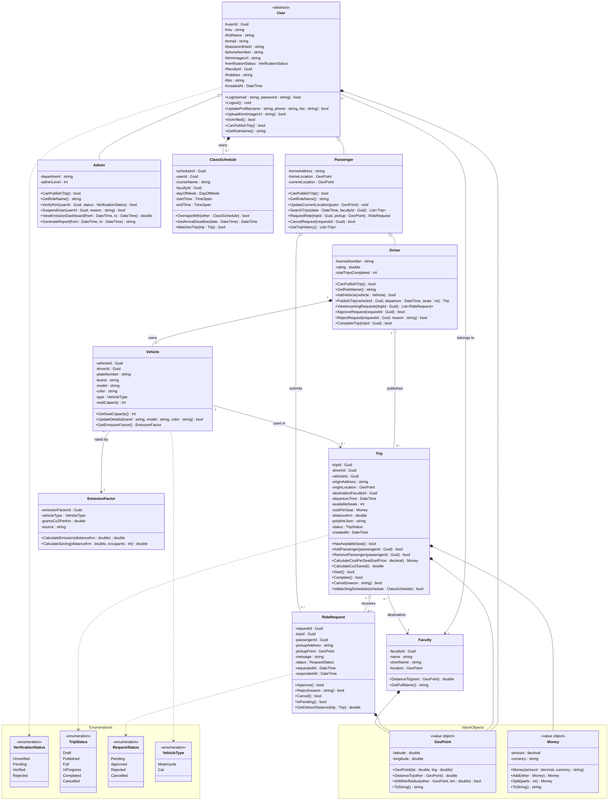

# BarengIn
Social carpooling for university students, matched by class schedule. Junior Project (OOP & Databases), DTETI FT UGM.

## About the Project
BarengIn is a carpooling and ride sharing platform built specifically for university students in Indonesia. By matching students' class schedules and destination faculties.

The app connects **Drivers** (students who already commute with a private vehicle and have empty seats) with **Passengers** (students without a vehicle who need a reliable, precisely timed ride to campus). Every user verifies their identity with their student ID (KTM), ensuring a safer and more trustworthy environment than conventional ride hailing apps.
Beyond just transportation, BarengIn layers in _social profiles_, such as hobbies and short bios so that daily commutes become an opportunity to meet like minded peers, giving drivers full control to approve or decline ride requests with zero pressure from the system.

The platform was created to address three interconnected problems on Indonesian campuses: chronic traffic congestion at campus gates driven by single occupancy commuting, the financial burden of daily transportation for students without vehicles, and the untapped potential for social connection during otherwise mundane commutes.

## Problem Statement
- Traffic congestion at campus gates caused by single occupancy commuting
- Unaffordable or unscheduled transport options for students without a vehicle
- Uneven cost burden on students who do own a vehicle
- Low social interaction during daily commutes
- No visibility into commute related carbon emissions

## Key Features
- Student ID (KTM) verification
- Automatic schedule and route matching between drivers and passengers
- Real time GPS tracking during a trip
- Social profiles with approve/reject matching
- Flexible, driver set cost sharing
- Admin dashboard for reports and CO2 savings analytics

## Climate Action Alignment
BarengIn reduces vehicle trips per capita by consolidating single occupancy commutes into shared rides, and gives campus administrators visibility into estimated emissions reduced through the admin dashboard.

## Team

BarengIn

- Member 1: Altaf Parves Shua Ilham – 24/536741/TK/59565
- Member 2: Calvin
- Member 3: M Dimas Dwi Ananda
- Member 4: Diffie Alfierie Iswanto

| Role | Name | NIU |
|---|---|---|
| Software Architect | Altaf Parves Shua Ilham | 24/536741/TK/59565 |
| Backend Engineer | Calvin | 24/532894/TK/59025 |
| Frontend Engineer | M Dimas Dwi Ananda | 24/536904/TK/59594 |
| Frontend Engineer | Diffie Alfierie Iswanto | 24/533049/TK/59056 |

## Tech Stack
| Layer | Technology |
|---|---|
| Desktop UI | C# (.NET 9), Avalonia UI 12.1.4 (Cross-Platform & Self-Contained Windows x64 `.exe`) |
| Architecture | Domain-Driven Layered Architecture (`BarengIn.Domain`, `BarengIn.Infrastructure`, `BarengIn.Desktop`) |
| Database | PostgreSQL 14+ with `Npgsql` (`docs/database/schema.sql`) + automatic zero-setup offline fallback |
| Web API Service | OpenStreetMap Nominatim Geocoding REST API + OSRM Driving Route REST API (`HttpClient` + `System.Text.Json`) |
| Automated Tests | xUnit (`BarengIn.Domain.Tests` & `BarengIn.Desktop.Tests` — headless Avalonia UI + live PostgreSQL + REST API suite) |

## Similar Apps
Gojek/GoCar, Grab, and BlaBlaCar are the closest comparisons. BarengIn differentiates on schedule based matching, social profiles, and a campus specific climate impact dashboard.

## Module 10 — Minimum Viable Product (Download, Quick Start & Testing)

### 1. Download the Self-Contained Windows `.exe` Package
- **GitHub Release (`v0.1.0-mvp`):** [Download `BarengIn-MVP-win-x64.zip`](https://github.com/altafparves/BarengIn/releases/tag/v0.1.0-mvp)
- Extract `BarengIn-MVP-win-x64.zip` and double-click **`BarengIn.Desktop.exe`**. No .NET SDK, Visual Studio, or database installation is required to test the application in **Offline Mode**.
- For full step-by-step Windows testing instructions, see [**`docs/WINDOWS-GUIDE.md`**](docs/WINDOWS-GUIDE.md).

### 2. Declared Administrator Credentials (Admin Dashboard)
To test the **Admin Dashboard** (KPI cards, KTM Verification queue, User Suspension, $\text{CO}_2$ Leaderboard, and 30-day Campus Sustainability Report):
- **Role:** `Admin`
- **Student ID (NIM) or UGM Email:** `admin@ugm.ac.id` (or `ADMIN/01` or `24/536741`)
- **Password:** `admin123`
*(Regular student accounts cannot log in with the `Admin` role.)*

### 3. Module 10 Documentation & Deliverables
| Deliverable | Location |
|---|---|
| **Windows Test Guide (Quick Start)** | [`docs/WINDOWS-GUIDE.md`](docs/WINDOWS-GUIDE.md) |
| **Module 10 Complete Guide (DB, Packaging & 6-Screen User Guide)** | [`docs/module-10/README.md`](docs/module-10/README.md) |
| **Lab 10.2 Black Box Testing Report (32 Test Cases + Screenshots)** | [`docs/module-10/BLACK_BOX_TESTING.md`](docs/module-10/BLACK_BOX_TESTING.md) |
| **Module 10 Homework Worksheet (`.pdf` & `.docx`)** | [`docs/module-10/WORKSHEET HOMEWORK 10.pdf`](docs/module-10/WORKSHEET%20HOMEWORK%2010.pdf) / [`WORKSHEET HOMEWORK 10.docx`](docs/module-10/WORKSHEET%20HOMEWORK%2010.docx) |
| **PostgreSQL Schema (`schema.sql`)** | [`docs/database/schema.sql`](docs/database/schema.sql) |
| **Windows Single-File Packaging Script** | [`scripts/package-windows.sh`](scripts/package-windows.sh) |

## Module 3 — Class Design

## Database setup
1. Create a PostgreSQL database named `barengin` and run `docs/database/schema.sql`.
2. Set the environment variable `BARENGIN_DB`, e.g.
   `Host=localhost;Port=5432;Database=barengin;Username=postgres;Password=...`
3. Restart your terminal, then `dotnet run --project src/BarengIn.Desktop`.