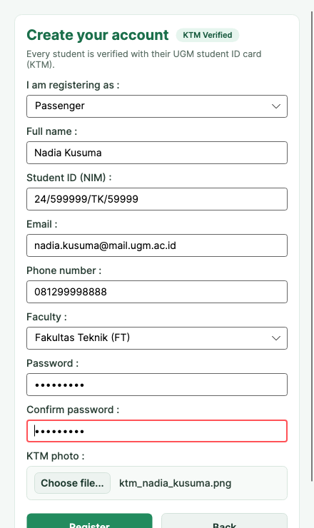
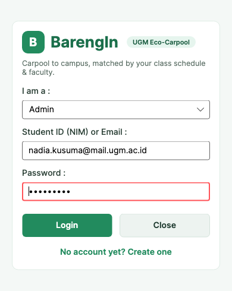
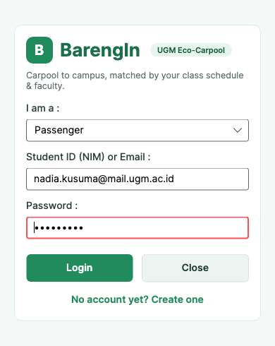
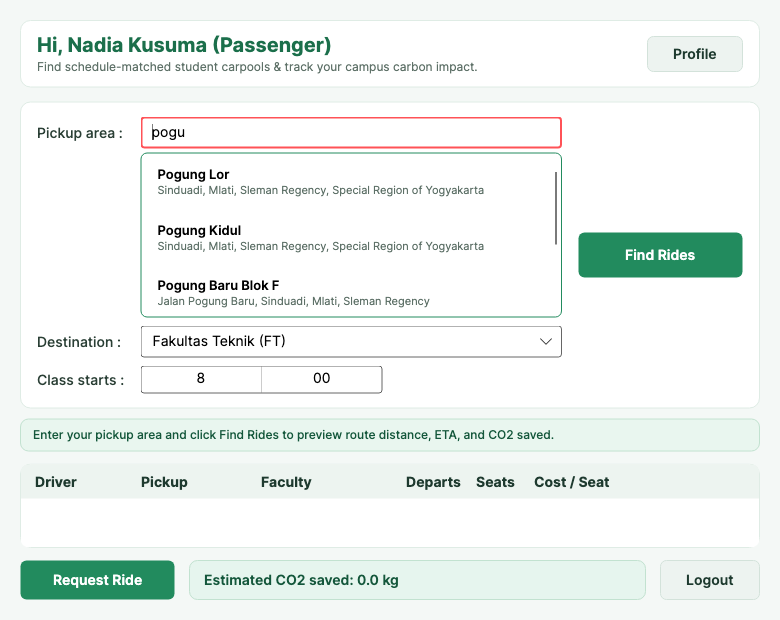
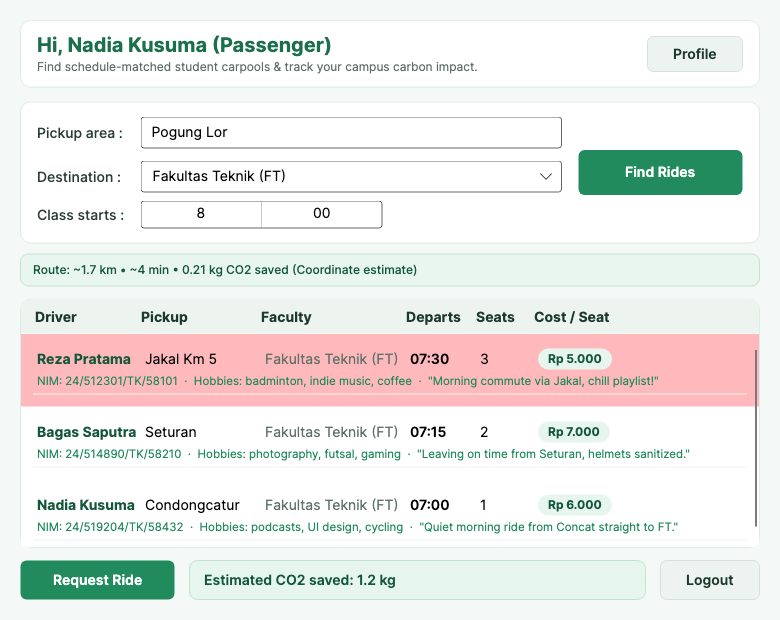
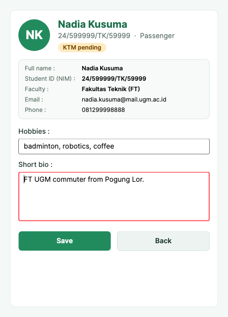
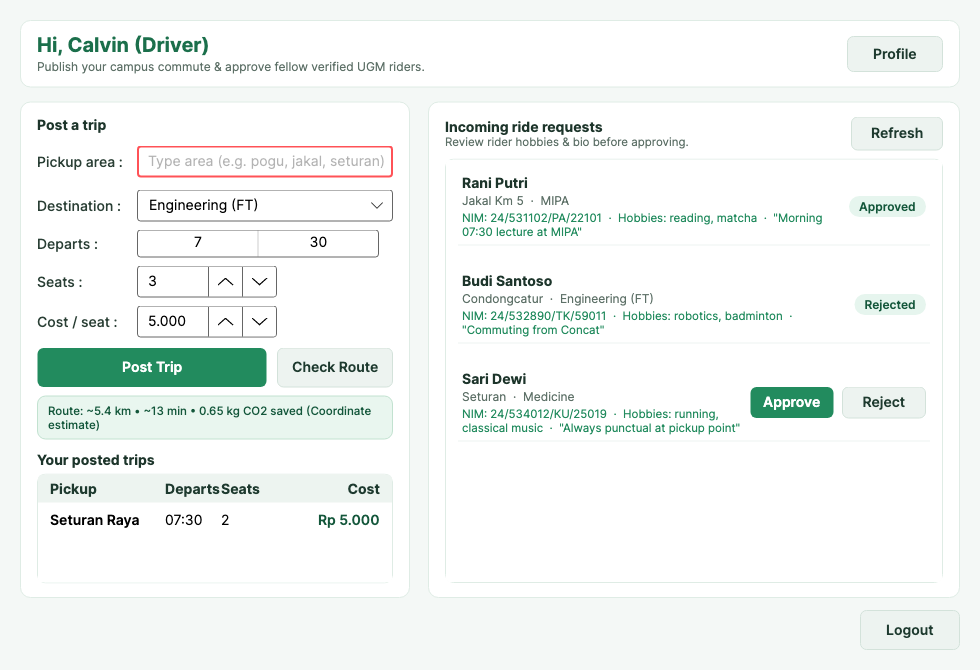
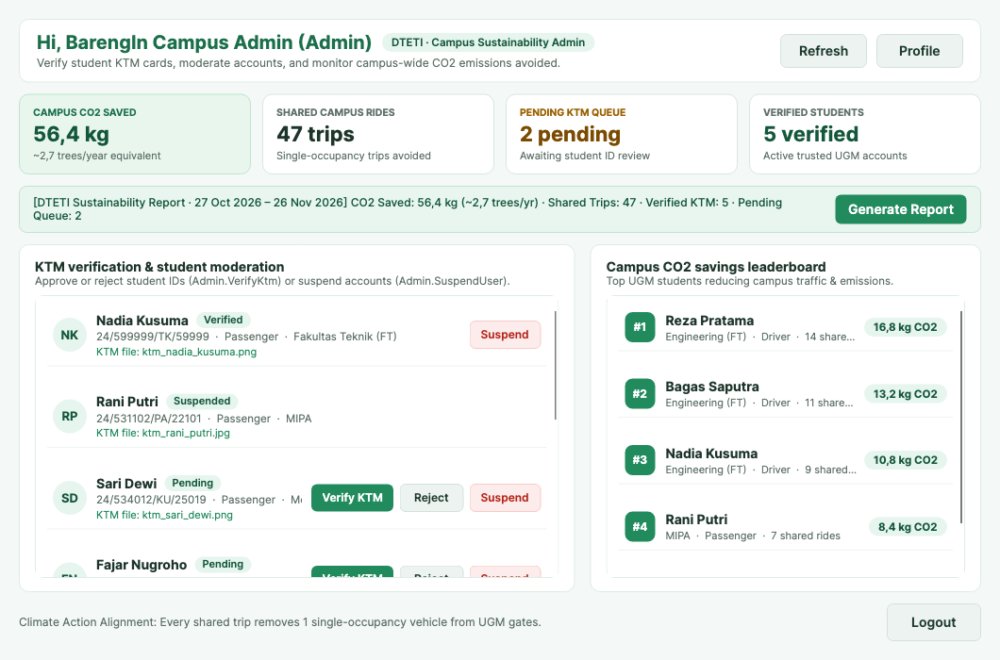
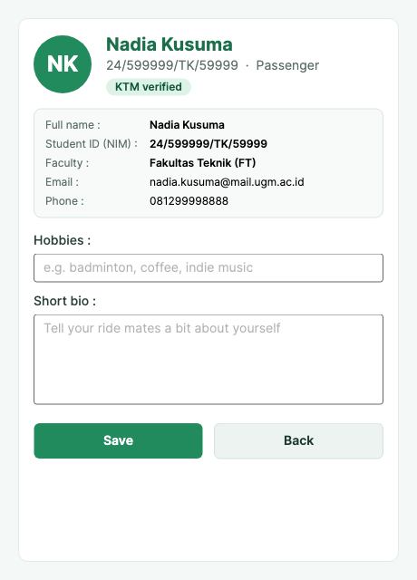

# Lab 10.2 — Black Box Testing Report (BarengIn Desktop MVP)

This document records the functional **Black Box Testing** conducted on the **BarengIn Desktop** application across all **six UI screens** (`RegisterWindow`, `LoginWindow`, `HomeWindow`, `DriverWindow`, `AdminWindow`, `ProfileWindow`), declared administrator access control, NIM/UGM email authentication, 33 UGM campus destinations, live Yogyakarta pickup autocomplete, read-only student identity cards with dynamic KTM verification badges, PostgreSQL database persistence, configuration loader, and OpenStreetMap (Nominatim + OSRM) route estimation.

---

## 1. Test Environment & Scope

- **Application Under Test:** `BarengIn.Desktop` (.NET 9, Avalonia UI 12.1.4) + `BarengIn.Infrastructure` + `BarengIn.Domain`
- **Desktop Bundle Tested:** `BarengIn.Desktop.exe` (`BarengIn-MVP-win-x64.zip` / `net9.0` desktop build)
- **Database & Configuration:** Local PostgreSQL instance (`barengin` database loaded with `docs/database/schema.sql`) and offline fallback mode (`appsettings.json` / `BARENGIN_DB`)
- **REST API Integration:** OpenStreetMap Nominatim Geocoding API + OSRM Routing API (`RouteApiService`) with curated Yogyakarta local landmark fallback
- **UI Screens Under Test (6 Windows):**
  1. **Register (`RegisterWindow`)** — Student account creation with Full Name, NIM, optional UGM Email & Phone, 33 UGM Faculty/Campus destinations, Role (`Passenger` / `Driver`), Password & Confirm Password, and KTM photo upload (new accounts start with **`KTM pending`** status).
  2. **Login (`LoginWindow`)** — Role selection (`Passenger`, `Driver`, `Admin`), authentication via **Student ID (NIM) or UGM Email**, and declared Administrator access protection.
  3. **Passenger Home (`HomeWindow`)** — Live Yogyakarta pickup autocomplete popup, ride search across 33 UGM destinations, driver social profile cards (NIM, hobbies, bio), live route distance/ETA/CO2 preview banner, and ride request submission with CO2 savings counter.
  4. **Driver Dashboard (`DriverWindow`)** — Pickup autocomplete, route preview (`Check Route`), trip publishing (`Post Trip`), incoming passenger request cards with social badges, transactional seat decrement on `Approve`, `Reject`, and `Refresh`.
  5. **Profile (`ProfileWindow`)** — Read-only student identity card (Full Name, NIM, Faculty, UGM Email, Phone), dynamic verification badge (`KTM verified`, `KTM pending`, `KTM rejected`, `Account suspended`), and editable Hobbies & Short bio.
  6. **Admin Dashboard (`AdminWindow`)** — Campus sustainability KPI cards (Total CO2 Saved, trees/year equivalent, Shared Rides, Pending KTMs, Verified Users), KTM Verification & User Moderation queue (`Verify KTM`, `Reject`, `Suspend`), Top CO2 Savers Leaderboard, and 30-day Sustainability Report generator.

---

## 2. Black Box Testing Summary Table (`BB-01` .. `BB-32`)

### Group A — Registration, NIM/Email Authentication, Declared Admin Guard & Navigation (`BB-01` .. `BB-09`)

| ID | Feature / Screen | Scenario / Input | Expected Output / Behavior | Observed Output / Behavior | Status |
|---|---|---|---|---|---|
| **BB-01** | Register (`RegisterWindow`) | Enter valid full name (`"Nadia Kusuma"`), NIM (`"24/599999/TK/59999"`), email (`"nadia.kusuma@mail.ugm.ac.id"`), phone (`"081299998888"`), faculty (`"Fakultas Teknik (FT)"`), matching 6+ char passwords, attach KTM photo (`"ktm_nadia_kusuma.png"`), and click **Register** | Account is created with initial verification status `"Pending"`, displays confirmation message `"Account created. Your KTM is being verified. You can log in now."`, and redirects to `LoginWindow` | Account registered with `Pending` KTM status; dialog shown and navigated to `LoginWindow` | **Match (v)** |
| **BB-02** | Register (`RegisterWindow`) | Enter mismatched password and confirm password (`"secret1"` vs `"secret2"`) and click **Register** | Displays `"Passwords do not match."` and keeps user on `RegisterWindow` | Alert dialog displays `"Passwords do not match."`; stays on `RegisterWindow` | **Match (v)** |
| **BB-03** | Register (`RegisterWindow`) | Leave KTM photo unattached (`No file chosen`) or enter password shorter than 6 characters and click **Register** | Displays `"Please attach a photo of your KTM."` / `"Password must be at least 6 characters."` and blocks registration | Exact error message displayed; registration blocked | **Match (v)** |
| **BB-04** | Register (`RegisterWindow`) | Enter an invalid email without `@` (`"invalid-email-without-at"`) or blank phone number when filling contact fields and click **Register** | Displays `"Please enter a valid email address."` or `"Please enter your phone number."` | Alert dialog shows `"Please enter a valid email address."` and stays on `RegisterWindow` | **Match (v)** |
| **BB-05** | Login (`LoginWindow`) | Leave NIM/Email or password blank and click **Login** | Displays `"Please enter your NIM and password."` and stays on `LoginWindow` | Alert dialog displays `"Please enter your NIM and password."`; stays on `LoginWindow` | **Match (v)** |
| **BB-06** | Login by NIM or Email (`LoginWindow`) | Log in using **Student ID (NIM)** (`"24/599999/TK/59999"`) or **UGM Email** (`"nadia.kusuma@mail.ugm.ac.id"`) as **Passenger** vs **Driver** | Both NIM and Email authenticate the student; `Passenger` opens `HomeWindow`, `Driver` opens `DriverWindow` with matching welcome banner | Both NIM and Email login succeed; opens `HomeWindow` (`Hi, Nadia Kusuma (Passenger)`) and `DriverWindow` (`(Driver)`) | **Match (v)** |
| **BB-07** | Admin Access Guard (`LoginWindow`) | Regular student (`"nadia.kusuma@mail.ugm.ac.id"`) selects Role = **Admin** and clicks **Login** | Login is denied with `"Access denied: Only declared BarengIn Administrators (e.g. admin@ugm.ac.id) can log in as Admin."` and stays on `LoginWindow` | Access denied alert displayed; unauthorized student blocked on `LoginWindow` | **Match (v)** |
| **BB-08** | Declared Admin Login (`LoginWindow`) | Select Role = **Admin**, enter declared administrator credentials (`"admin@ugm.ac.id"`, `"ADMIN/01"`, or `"24/536741"` with `"admin123"`), and click **Login** | Authenticates as `Admin` and opens `AdminWindow` (`"Hi, BarengIn Campus Admin (Admin)"`) | Opens `AdminWindow` with populated KPI cards, KTM queue, and CO2 leaderboard | **Match (v)** |
| **BB-09** | 6-Window Navigation (`Navigator`) | Click **No account yet? Create one**, **Back**, **Profile**, **Back**, and **Logout** across `LoginWindow`, `RegisterWindow`, `HomeWindow`, `DriverWindow`, `AdminWindow`, and `ProfileWindow` | Transitions cleanly between all 6 screens; clicking **Back** from `ProfileWindow` returns to the active role's dashboard (`HomeWindow`, `DriverWindow`, or `AdminWindow`) | All window transitions and logout flows return to the expected screen without error | **Match (v)** |

### Group B — Passenger Ride Search, Pickup Autocomplete, Social Cards & CO2 Impact (`BB-10` .. `BB-13`)

| ID | Feature / Screen | Scenario / Input | Expected Output / Behavior | Observed Output / Behavior | Status |
|---|---|---|---|---|---|
| **BB-10** | Pickup Autocomplete (`HomeWindow` & `DriverWindow`) | Type `"pogu"` or `"jakal"` into the **Pickup area** input box and click a suggested location from the dropdown | Autocomplete popup opens immediately with matching Yogyakarta student areas (e.g., `"Pogung Lor"`, `"Pogung Kidul"`, `"Jakal Km 5"`); clicking an item fills the textbox, closes the popup, and previews the route | Dropdown lists matching Yogyakarta places; selecting `"Pogung Lor"` fills `tbOrigin` and hides the popup | **Match (v)** |
| **BB-11** | Passenger Ride Search (`HomeWindow`) | Enter pickup `"Pogung Lor"`, select destination `"Fakultas Teknik (FT)"`, and click **Find Rides** | Populates `lvRides` with 3 available rides showing driver name, NIM, pickup point, departure time, seats, cost, and driver social profile (hobbies & bio), and updates the route preview banner | 3 rides displayed (`07:30`, `07:15`, `07:00`) with driver social cards and route estimate summary | **Match (v)** |
| **BB-12** | Passenger Empty Pickup Guard (`HomeWindow`) | Leave **Pickup area** blank (`""`) and click **Find Rides** | Displays `"Please enter your pickup area."`; ride list remains empty | Alert dialog shown; `lvRides` remains empty | **Match (v)** |
| **BB-13** | Passenger Request Ride & CO2 (`HomeWindow`) | Click **Request Ride** without selecting a ride vs after selecting a ride row | Without selection: prompts `"Please select a ride first."` and CO2 stays `0.0 kg`; with selection: sends request and increments **Estimated CO2 saved** to `1.2 kg` | Unselected keeps `"Estimated CO2 saved: 0.0 kg"`; selected request updates banner to `"Estimated CO2 saved: 1.2 kg"` | **Match (v)** |

### Group C — Driver Dashboard, Trip Publishing & Request Management (`BB-14` .. `BB-16`)

| ID | Feature / Screen | Scenario / Input | Expected Output / Behavior | Observed Output / Behavior | Status |
|---|---|---|---|---|---|
| **BB-14** | Driver Post Trip (`DriverWindow`) | Click **Post Trip** with empty pickup vs valid pickup (`"Seturan Raya"`), destination faculty, departure `07:30`, `3` seats, `Rp 5.000` | Empty pickup shows validation prompt; valid pickup adds `Seturan Raya` trip (`07:30`, `3` seats, `Rp 5.000`) to **Your posted trips** and updates route preview | Empty pickup rejected; valid submission adds `Seturan Raya` row (`3` seats, `Rp 5.000`) and updates route banner | **Match (v)** |
| **BB-15** | Driver Approve & Reject Requests (`DriverWindow`) | Click **Approve** on 1st passenger request (`Rani Putri`) and **Reject** on 2nd request (`Budi Santoso`) | 1st request status changes to `"Approved"` and decrements trip seats (`3 -> 2`); 2nd request status changes to `"Rejected"`; 3rd stays `"Pending"` | 1st row shows `"Approved"`, 2nd shows `"Rejected"`, 3rd shows `"Pending"`, and trip seats decrement `3 -> 2` | **Match (v)** |
| **BB-16** | Driver Refresh (`DriverWindow`) | Click **Refresh** next to **Incoming passenger requests** | Reloads trips and requests from PostgreSQL when connected, or preserves current requests cleanly in offline mode | All 3 passenger requests and posted trips remain intact without error | **Match (v)** |

### Group D — Admin Dashboard, KTM Verification Queue, Suspension & Sustainability Reports (`BB-17` .. `BB-20`)

| ID | Feature / Screen | Scenario / Input | Expected Output / Behavior | Observed Output / Behavior | Status |
|---|---|---|---|---|---|
| **BB-17** | Admin Verify KTM (`AdminWindow`) | Newly registered student (`"Nadia Kusuma"`, `24/599999/TK/59999`) appears in the Admin queue as `"Pending"`; Admin clicks **Verify KTM** | Student status badge changes `"Pending" -> "Verified"`, **Pending KTMs** KPI counter decrements by 1, **Verified Users** increments by 1, and the student's profile badge updates to **`KTM verified`** | Status updates to `"Verified"`, KPI counters update (`4 -> 3 pending`, `4 -> 5 verified`), and student's Profile shows `"KTM verified"` | **Match (v)** |
| **BB-18** | Admin Reject KTM (`AdminWindow`) | Admin clicks **Reject** on a pending KTM row (`Rani Putri`) in the moderation list | Row status transitions `"Pending" -> "Rejected"` and **Pending KTMs** KPI counter decrements by 1 | Row badge updates to `"Rejected"` and pending counter decrements (`3 -> 2 pending`) | **Match (v)** |
| **BB-19** | Admin Suspend User (`AdminWindow`) | Admin clicks **Suspend** on an active user row in the moderation list | User status changes to `"Suspended"` (red badge) and the **Suspend** button is disabled for that row | Row status updates to `"Suspended"` and persists in user store | **Match (v)** |
| **BB-20** | Admin KPI Cards, CO2 Leaderboard & Report (`AdminWindow`) | Inspect KPI cards and **Top CO2 Savers Leaderboard**, then click **Generate Report** | Displays Total CO2 Saved (`56.4 kg`, `~2.7 trees/year equivalent`), Shared Rides (`47 trips`), Pending KTMs, Verified Users, 5 ranked leaderboard commuters, and a 30-day Sustainability Report dialog | All 4 KPI cards, 5 leaderboard rows, and Sustainability Report summary banner & popup render accurately | **Match (v)** |

### Group E — Profile Identity Card, Badges, PostgreSQL Persistence & REST API Routing (`BB-21` .. `BB-32`)

| ID | Feature / Screen | Scenario / Input | Expected Output / Behavior | Observed Output / Behavior | Status |
|---|---|---|---|---|---|
| **BB-21** | Read-Only Profile Identity Card & Bio Save (`ProfileWindow`) | Open `ProfileWindow`, check identity fields, edit **Hobbies** (`"badminton, robotics, coffee"`) and **Short bio**, and click **Save** | Displays read-only Full Name, NIM, Faculty, UGM Email, and Phone; clicking **Save** updates session & database hobbies/bio and shows `"Profile saved (Hobbies & Bio updated)."` | All 5 read-only identity fields match registered data; hobbies and bio save cleanly | **Match (v)** |
| **BB-22** | Dynamic Profile KTM Status Badges (`ProfileWindow`) | Open `ProfileWindow` before Admin verification (`Pending`), after Admin verification (`Verified`), or when `Rejected` / `Suspended` | Displays `"KTM pending"` (amber badge), `"KTM verified"` (green badge), `"KTM rejected"` (red badge), or `"Account suspended"` (red badge) | Badge text and color theme update dynamically to match the user's current verification status | **Match (v)** |
| **BB-23** | Config Priority & Edge Cases (`AppDb`) | Test `BARENGIN_DB` env vs `appsettings.json` vs `PASSWORDHERE` template; test whitespace env, malformed JSON, missing file, and JSON with comments/trailing commas | `BARENGIN_DB` overrides `appsettings.json`; `PASSWORDHERE` or missing/malformed files fall back to offline mode cleanly; comments & trailing commas parse without error | Exact configuration priority and resilient offline fallback observed across all cases | **Match (v)** |
| **BB-24** | PostgreSQL Atomic Seat Decrement & Overbooking Guard (`RideRepository`) | Live PostgreSQL: 1-seat ride with 2 pending requests; approve 1st, approve 1st again, approve 2nd, reject 1st, reject 2nd | 1st approve succeeds (`seats: 1 -> 0`); double-approve returns `false`; 2nd approve is blocked (`available_seats == 0`, preventing overbooking); rejecting accepted request fails; rejecting 2nd pending request succeeds | Verified against live PostgreSQL transaction with `FOR UPDATE` row locking | **Match (v)** |
| **BB-25** | PostgreSQL Profile Persistence (`UserRepository`) | Register user in PostgreSQL -> update hobbies, bio, and faculty via `UpdateProfile` -> log out and re-authenticate | Updated hobbies, bio, and faculty persist in `users` table and are restored into `AppSession` on re-login | Profile changes persist across logout and re-login in PostgreSQL | **Match (v)** |
| **BB-26** | Live UI + PostgreSQL End-to-End Flow (`DriverWindow` + `ProfileWindow`) | Login as DB driver -> load DB ride & requests -> click **Approve** -> click **Refresh** -> click **Reject** -> save `ProfileWindow` -> re-login | UI loads live DB rows, decrements seat `1 -> 0` on approve, preserves state on refresh, rejects remaining request, and persists profile across re-login | Full UI + PostgreSQL end-to-end flow succeeds | **Match (v)** |
| **BB-27** | 33 UGM Campus Coordinates & JSON Parsers (`RouteApiService`) | Query coordinates for all 33 `Faculties.All` destinations (18 faculties, schools, campus landmarks) + unknown faculty fallback; parse valid & malformed Nominatim/OSRM JSON | Distinct valid Yogyakarta coordinates (`Lat -8.0..-7.5`, `Lon 110.0..110.6`) for all 33 UGM destinations; Bulaksumur fallback `(-7.7702, 110.3775)` for unknown input | All 33 UGM destinations resolve to accurate campus coordinates; invalid JSON returns `null` safely | **Match (v)** |
| **BB-28** | REST API Live Route Calculation (`RouteApiService`) | Nominatim + OSRM route lookup (`8500 m`, `1080 s`) including under comma-decimal locale (`de-DE`) | Sets `User-Agent` header and `4s` timeout, formats dot-decimal OSRM URLs, and computes `8.5 km`, `18 min`, `1.02 kg CO2 saved` | Accurate distance, ETA, and CO2 calculation verified under invariant formatting | **Match (v)** |
| **BB-29** | REST API `"Jakal"` Abbreviation Retry (`RouteApiService`) | Search pickup `"Jakal Km 5"` when first Nominatim query returns empty `[]` | Automatically retries by expanding `"Jakal"` to `"Jalan Kaliurang"` before calling OSRM | Second Nominatim query resolves `"Jalan Kaliurang"` and returns live route estimate | **Match (v)** |
| **BB-30** | REST API Offline Fallback (`RouteApiService`) | Blank pickup, HTTP `429`/`500`/`503`, empty geocoding result, network disconnect, or request timeout | Never crashes; returns offline fallback estimate (`~5.0 km • ~12 min • 0.60 kg CO2 saved (Offline estimate)`) | UI displays `"Fallback: ..."` banner cleanly without unhandled exceptions | **Match (v)** |
| **BB-31** | Local Yogyakarta Place Suggestions (`RouteApiService`) | Search `"pogu"` or `"jakal km 5"` in local place dictionary | Returns curated Yogyakarta student residential areas (`"Pogung Lor"`, `"Pogung Kidul"`, `"Jakal Km 5"`) with coordinates | Instant local suggestions returned with zero network delay | **Match (v)** |
| **BB-32** | UI Route Preview & 6-Window Resize Bounds (`All Windows`) | Trigger route lookup (`"Checking route..."` -> `"Route: ..."` / `"Fallback: ..."`) and resize all 6 windows (`Login`, `Register`, `Profile`, `Home`, `Driver`, `Admin`) | Immediate `"Checking route..."` feedback before async completion; all 6 windows support resizing (`CanResize == true`) with enforced minimum dimensions | Verified across all 6 application windows | **Match (v)** |

---

## 3. Visual Black Box Testing Walkthrough & Evidence

### Test Case Group 1 — Student Registration (`BB-01` .. `BB-04`)
- **Action:** Opened `RegisterWindow`, tested validation guards (mismatched passwords, missing KTM attachment, invalid email without `@`), then filled in student details for **Nadia Kusuma** (`24/599999/TK/59999`, `nadia.kusuma@mail.ugm.ac.id`, `081299998888`, `Fakultas Teknik (FT)`, role `Passenger`, KTM file `ktm_nadia_kusuma.png`) and clicked **Register**.
- **Result:** Account registered with initial verification status **`Pending`** and redirected to `LoginWindow`.

---

### Test Case Group 2 — Declared Admin Guard & Login by Email/NIM (`BB-05` .. `BB-08`)
- **Action 1 (Unauthorized Admin Attempt — `BB-07`):** Selected Role = **Admin** on `LoginWindow` and attempted to log in using the regular student account `nadia.kusuma@mail.ugm.ac.id`.
- **Result 1:** Blocked on `LoginWindow` with message: *"Access denied: Only declared BarengIn Administrators (e.g. admin@ugm.ac.id) can log in as Admin."*
- **Action 2 (Student Login via UGM Email — `BB-06`):** Selected Role = **Passenger** and logged in using `nadia.kusuma@mail.ugm.ac.id` and `secret123`.
- **Result 2:** Authenticated and navigated to `HomeWindow` (`Hi, Nadia Kusuma (Passenger)`).

| Unauthorized Admin Login Attempt (`BB-07`) | Valid Student Login via Email (`BB-06`) |
|---|---|
|  |  |

---

### Test Case Group 3 — Passenger Pickup Autocomplete, Ride Search & CO2 Saved (`BB-10` .. `BB-13`)
- **Action 1 (Pickup Autocomplete — `BB-10`):** Typed `"pogu"` into **Pickup area** on `HomeWindow`.
- **Result 1:** Live autocomplete popup displayed Yogyakarta locations (`Pogung Lor`, `Pogung Kidul`, `Pogung Baru`, `Pogung Dalangan`). Clicking **`Pogung Lor`** populated the pickup field and previewed the route.
- **Action 2 (Ride Search & Request — `BB-11`, `BB-13`):** Selected destination **`Fakultas Teknik (FT)`**, clicked **Find Rides** (displaying 3 rides with driver social profiles and route summary `Route: ~1.7 km • ~4 min • 0.21 kg CO2 saved`), selected the first ride (`Reza Pratama`), and clicked **Request Ride**.
- **Result 2:** Request submitted and **Estimated CO2 saved** counter incremented from `0.0 kg` to `1.2 kg`.

| Live Pickup Autocomplete Popup (`BB-10`) | Ride Search Results, Route Banner & CO2 Saved (`BB-11`, `BB-13`) |
|---|---|
|  |  |

---

### Test Case Group 4 — Student Profile Identity Card & Initial `KTM pending` Status (`BB-21`, `BB-22`)
- **Action:** Clicked **Profile** from `HomeWindow` as newly registered student **Nadia Kusuma**, verified the read-only student identity card (Full name, NIM, Faculty, UGM Email, Phone), entered hobbies (`badminton, robotics, coffee`) and bio (`FT UGM commuter from Pogung Lor.`), and clicked **Save**.
- **Result:** Read-only identity fields matched registration data, verification badge displayed **`KTM pending`** (amber badge) prior to Admin review, and updated hobbies/bio were saved.

---

### Test Case Group 5 — Driver Dashboard: Trip Publishing & Request Approval/Rejection (`BB-14` .. `BB-16`)
- **Action:** Logged in as **Driver** (`24/532894/TK/59025`), selected pickup **`Seturan Raya`** via autocomplete, clicked **Post Trip** (`07:30`, `3` seats, `Rp 5.000`), clicked **Approve** on the 1st incoming passenger request (`Rani Putri`), and clicked **Reject** on the 2nd request (`Budi Santoso`).
- **Result:** Posted trip appeared in **Your posted trips**, approving `Rani Putri` changed her badge to **`Approved`** and decremented available seats from **`3` to `2`**, and rejecting `Budi Santoso` updated his badge to **`Rejected`**.

---

### Test Case Group 6 — Admin Dashboard: KTM Verification, Rejection, Suspension & End-to-End Badge Sync (`BB-08`, `BB-09`, `BB-17` .. `BB-20`)
- **Action 1 (Admin Moderation & Report — `BB-17`..`BB-20`):** Logged in as declared **Admin** (`admin@ugm.ac.id` / `admin123`), clicked **Verify KTM** on **Nadia Kusuma** (`24/599999/TK/59999`), clicked **Reject** on the next pending request (`Rani Putri`), clicked **Suspend** on an account, and clicked **Generate Report**.
- **Result 1:** Nadia Kusuma's status transitioned from **`Pending` to `Verified`**, `Rani Putri` transitioned to **`Rejected`**, the suspended account transitioned to **`Suspended`**, KPI cards updated (`3 -> 2 pending`, `5 verified`), and the 30-day Campus Sustainability Report was generated alongside the Top CO2 Savers Leaderboard.
- **Action 2 (End-to-End Student Profile Verification — `BB-09`, `BB-22`):** Logged back in as **Nadia Kusuma** (`24/599999/TK/59999`) and opened **Profile**.
- **Result 2:** Her profile badge automatically updated from **`KTM pending`** (amber) to **`KTM verified`** (green).

| Admin Dashboard After Verify, Reject & Suspend (`BB-17`..`BB-20`) | Student Profile After Admin Verification (`BB-09`, `BB-22`) |
|---|---|
|  |  |
