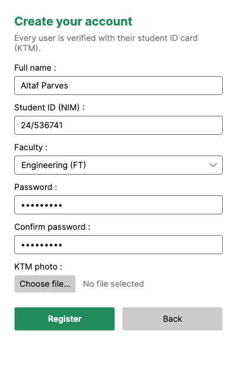
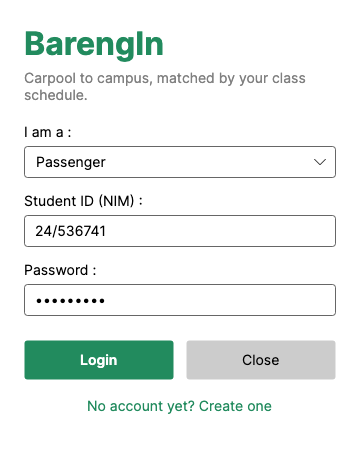
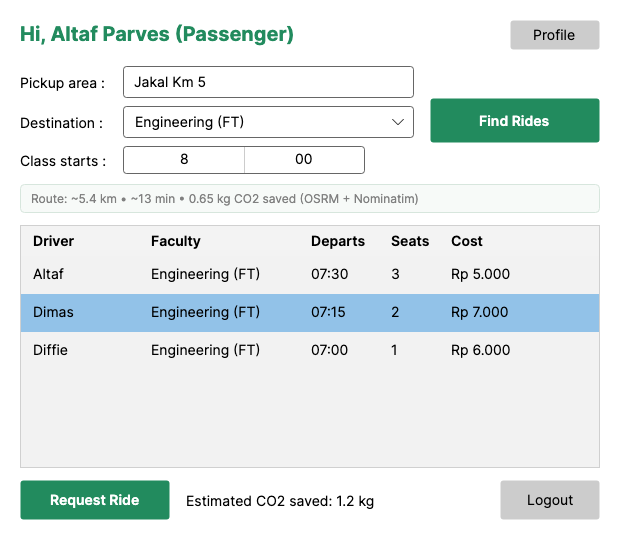
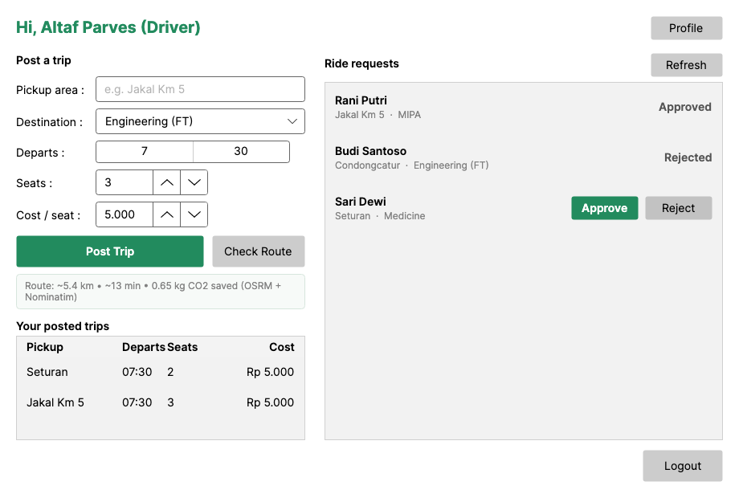
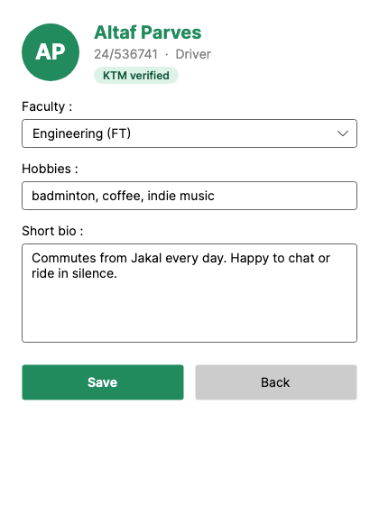

# Module 10 Guide — BarengIn Desktop MVP (Database, Packaging, Usage & Testing)

This guide covers setting up PostgreSQL (or running in offline mode), packaging and running the Windows `.exe` bundle, using every screen of the BarengIn Desktop application, and reviewing the [Lab 10.2 Black Box Testing Report](BLACK_BOX_TESTING.md).

---

## 1. Database Configuration Guide (PostgreSQL)

BarengIn uses PostgreSQL (`Npgsql`) when configured and automatically falls back to offline sample/in-memory mode when no database is available.

### Setup Steps
1. Ensure PostgreSQL (14+) is running locally (default port `5432`).
2. Create the database and apply the schema from [`docs/database/schema.sql`](../database/schema.sql):
   ```sql
   CREATE DATABASE barengin;
   ```
   ```bash
   psql -U postgres -d barengin -f docs/database/schema.sql
   ```
3. Configure the connection string using **either**:
   - **`appsettings.json`** (recommended for packaged `.exe` runs, located beside `BarengIn.Desktop.exe` or in `src/BarengIn.Desktop/appsettings.json`):
     ```json
     {
       "ConnectionStrings": {
         "Default": "Host=localhost;Port=5432;Database=barengin;Username=postgres;Password=YOUR_PASSWORD"
       }
     }
     ```
   - **Environment variable `BARENGIN_DB`** (highest priority, overrides `appsettings.json`):
     ```powershell
     $env:BARENGIN_DB = "Host=localhost;Port=5432;Database=barengin;Username=postgres;Password=YOUR_PASSWORD"
     ```

### Config Priority & Offline Fallback
`AppDb.ConnectionString` resolves in this order:
1. Non-whitespace `BARENGIN_DB` environment variable
2. `ConnectionStrings:Default` from `appsettings.json` (in `AppContext.BaseDirectory` or current working directory; comments and trailing commas are tolerated)
3. Built-in default template (`Password=PASSWORDHERE`)

If the resolved connection string still contains `PASSWORDHERE`, is blank, or PostgreSQL is unreachable, `AppDb.IsAvailable` returns `false` and the app runs cleanly in offline fallback mode.

---

## 2. Windows `.exe` Installation & Packaging Guide

### Building the Bundle (macOS/Linux/CI)
Run the packaging script from the repository root:
```bash
./scripts/package-windows.sh
```
This publishes a self-contained single-file `win-x64` binary (`-p:PublishSingleFile=true -p:IncludeNativeLibrariesForSelfExtract=true`) with `appsettings.json` excluded from the single-file archive so users can edit it directly, and creates `dist/BarengIn-MVP-win-x64.zip` containing:
- `BarengIn.Desktop.exe` — Self-contained .NET 9 Avalonia desktop app
- `appsettings.json` — Database connection template
- `schema.sql` — Copy of `docs/database/schema.sql`
- `README-RUN.txt` — Windows quick-start instructions

### Installing & Running on Windows 10/11
1. Extract all files from `BarengIn-MVP-win-x64.zip` into a folder (do not launch from inside the ZIP preview).
2. **Offline mode:** Leave `Password=PASSWORDHERE` in `appsettings.json` and double-click `BarengIn.Desktop.exe`.
3. **PostgreSQL mode:** Create the `barengin` database, load `schema.sql`, update `Password=` in `appsettings.json`, and launch `BarengIn.Desktop.exe`.
4. If Windows Defender SmartScreen prompts on the unsigned academic binary, click **More info** -> **Run anyway**.

---

## 3. Step-by-Step User Guide

### Step 1 — Create an Account (`RegisterWindow`)
Click **No account yet? Create one** on the login screen to open registration. Enter your **Full name**, **Student ID (NIM)**, **Faculty**, **Password** (minimum 6 characters), **Confirm password**, and attach a KTM image via **Choose file...**, then click **Register**.



### Step 2 — Log In (`LoginWindow`)
Choose your role (**Passenger** or **Driver**), enter your **Student ID (NIM)** and **Password**, and click **Login**. When connected to PostgreSQL, login restores your saved faculty, hobbies, and bio into the session.



### Step 3 — Search Rides, Route Preview & Request a Ride (`HomeWindow`)
As a **Passenger**, enter your **Pickup area** (e.g., `Jakal Km 5`), pick your destination **Faculty** and **Class starts** time, and click **Find Rides**:
- Available rides appear immediately in the table.
- The route preview banner displays `"Checking route..."` and then queries OpenStreetMap Nominatim + OSRM (`RouteApiService`) to display estimated distance, travel time, and CO2 saved (falling back to `"Offline estimate"` when offline).
- Select a ride and click **Request Ride** to submit a request and increment **Estimated CO2 saved**.



### Step 4 — Publish Trips, Preview Routes & Manage Requests (`DriverWindow`)
As a **Driver**, enter a pickup area, destination faculty, departure time, seats, and cost/seat:
- Click **Check Route** to preview distance, ETA, and CO2 savings without posting yet, or click **Post Trip** to publish the trip (persisted to PostgreSQL when available) and update the route preview.
- Click **Refresh** next to **Ride requests** to reload posted trips and incoming passenger requests from PostgreSQL.
- Click **Approve** or **Reject** on a pending request. Approving atomically decrements `available_seats` in PostgreSQL inside a transaction and prevents overbooking when seats reach `0`.



### Step 5 — Edit Profile (`ProfileWindow`)
Click **Profile** from either the Passenger or Driver screen to view your KTM verification badge and update your **Faculty**, **Hobbies**, and **Short bio**. Click **Save** to update the active session and persist the changes to PostgreSQL (`users.faculty_id`, `hobbies`, `bio`).



---

## 4. Black Box Testing (Lab 10.2)

See [`BLACK_BOX_TESTING.md`](BLACK_BOX_TESTING.md) for the full 24-case Black Box Testing table (`BB-01`–`BB-24`), detailed case breakdowns, and automated test traceability matrix.
