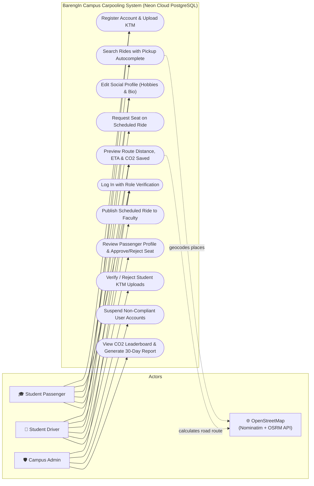

# BarengIn Presentation Technical Resources & Justifications

This document provides ready-to-use technical reference material, architecture justifications, diagrams, OOP code references, testing metrics, and demo account tables for the Group 5 presentation slides.

---

## 1. Tech Stack & Engineering Justification (Why Avalonia UI on macOS -> Windows `.exe`)

### Tech Stack Overview Table

| Layer | Technology | Role in BarengIn |
| :--- | :--- | :--- |
| **Language & Runtime** | **C# 13 / .NET 9** | Strongly typed OOP domain modeling, async/await HTTP clients, and cross-platform single-file compilation. |
| **Desktop UI Framework** | **Avalonia UI 11/12** | Cross-platform XAML desktop UI rendered via Skia; developed natively on macOS and compiled into a standalone Windows x64 `.exe`. |
| **Architecture Pattern** | **Domain-Driven Layered Architecture** | Strict separation between `BarengIn.Domain` (pure OOP, 0 dependencies), `BarengIn.Infrastructure` (PostgreSQL + REST APIs), and `BarengIn.Desktop` (UI). |
| **Cloud Database** | **Neon Serverless PostgreSQL 16 + `Npgsql` 10.0.3** | Online relational database hosted in AWS Singapore (`ap-southeast-1`) with 15 tables, 10 enum types, 18 indexes, and transactional row locking (`FOR UPDATE`). |
| **External Web APIs** | **OpenStreetMap Nominatim + OSRM Routing API** | Live geocoding for Yogyakarta pickup autocomplete, driving route distance (`km`), travel duration (`min`), and $\text{CO}_2$ savings calculation. |
| **Authentication Security** | **`BCrypt.Net-Next` 4.2.0** | Salted password hashing (`$2a$11$...`) and role-based access control with a declared-administrator guard. |
| **Automated Testing** | **xUnit + `Avalonia.Headless.XUnit`** | 81 automated unit, repository, REST API, and headless multi-window UI tests + 32 Black Box test cases. |

### Why We Chose Avalonia UI (The macOS -> Windows `.exe` Justification)
1. **Cross-Platform Development on macOS with Native Windows Deliverable:**
   - The course requires a runnable Windows `.exe` submission, while our technical lead develops on a **MacBook (macOS)**.
   - Legacy .NET desktop frameworks (**WinForms** and **WPF**) depend on the Windows-only `User32`/`GDI+`/`DirectX` stack and **cannot run, render, or be tested on macOS**.
   - **Avalonia UI** uses a platform-independent Skia rendering engine. We wrote, debugged, and ran the exact same desktop windows natively on macOS during development, then cross-compiled a self-contained Windows x64 single-file executable (`BarengIn.Desktop.exe`) using one command (`./scripts/package-windows.sh`).
2. **Zero-Install Self-Contained `.exe` for Evaluators:**
   - Using `.NET 9` single-file publishing (`-r win-x64 --self-contained true -p:PublishSingleFile=true -p:IncludeNativeLibrariesForSelfExtract=true`), the entire .NET 9 runtime and Avalonia native libraries are embedded inside `BarengIn.Desktop.exe`. Lecturers can double-click the `.exe` on any Windows 10/11 PC without installing Visual Studio or the .NET SDK.
3. **Deterministic Headless UI Testing:**
   - Avalonia provides `Avalonia.Headless.XUnit`, allowing our test suite to spin up real windows (`LoginWindow`, `RegisterWindow`, `HomeWindow`, `DriverWindow`, `ProfileWindow`, `AdminWindow`), simulate button clicks and text input, and assert UI state in milliseconds on macOS and CI.

### Why We Chose Neon Cloud PostgreSQL (`ap-southeast-1` Singapore)
1. **Meets the Non-Local Database Requirement with Low Latency:**
   - Hosted in **AWS Asia Pacific (Singapore)**, providing low round-trip latency from Yogyakarta.
2. **No 7-Day Inactivity Pause During Grading:**
   - Unlike Supabase's free tier (which pauses databases after 7 days of inactivity and requires manual unpausing in a dashboard), Neon's serverless compute wakes up automatically in `< 500 ms` whenever `BarengIn.Desktop.exe` opens a connection.
3. **Graceful Offline Fallback (`AppDb.cs`):**
   - `AppDb.ConnectionString` checks the `BARENGIN_DB` environment variable first, then `appsettings.json` beside `BarengIn.Desktop.exe`. If the user has no internet connection during testing, `AppDb.IsAvailable` catches the connection failure and switches cleanly to offline fallback mode so the UI never crashes.

---

## 2. Task Distribution (Group 5 Division of Work)

| Member Name | NIU / NIM | Role | Key Responsibilities & Modules Owned |
| :--- | :--- | :--- | :--- |
| **Altaf Parves Shua Ilham** | `24/536741/TK/59565` | **Software Architect & Technical Lead** | System architecture (ADR-0001), OOP domain model design, OpenStreetMap Nominatim + OSRM `RouteApiService`, Neon cloud database deployment, cross-platform macOS-to-Windows `.exe` packaging, and demo video production. |
| **Calvin** | `24/532894/TK/59025` | **Backend & Database Engineer** | 15-table PostgreSQL schema (`schema.sql`), custom enums & indexes, `UserRepository` (BCrypt auth & KTM verification), `RideRepository` (`FOR UPDATE` atomic seat approval & analytics queries). |
| **M Dimas Dwi Ananda** | `24/536904/TK/59594` | **Frontend Engineer** | Avalonia UI screen implementation (`LoginWindow`, `RegisterWindow`, `HomeWindow`, `ProfileWindow`), pickup autocomplete dropdown UX, and responsive window layout constraints. |
| **Diffie Alfierie Iswanto** | `24/533049/TK/59056` | **Frontend & QA Engineer** | `DriverWindow` and `AdminWindow` UI flows (KPI cards, KTM moderation queue, $\text{CO}_2$ leaderboard, 30-day sustainability report), and Lab 10.2 Black Box Testing (32 test cases & screenshots). |

---

## 3. ERD & Use Case Diagram

### Entity Relationship Diagram (ERD)
- **File in repo:** [`docs/diagrams/BarengIn ERD.png`](../diagrams/BarengIn%20ERD.png)
- **Schema file:** [`docs/database/schema.sql`](../database/schema.sql)
- **Highlights to mention on the ERD slide:**
  - **15 Normalized Tables:** `faculty`, `users`, `passenger`, `driver`, `admin`, `ktm_verification`, `schedule`, `vehicle`, `ride`, `ride_request`, `payment`, `location_log`, `co2_log`, `report`, `rating`.
  - **Table-Per-Type Role Extension Pattern:** `passenger`, `driver`, and `admin` share `user_id` as both Primary Key and Foreign Key referencing `users(user_id) ON DELETE CASCADE`, enforcing 1-to-(0..1) role specialization in SQL that mirrors the OOP inheritance hierarchy.
  - **Data Integrity Constraints:** 10 PostgreSQL `ENUM` types, latitude/longitude range `CHECK` constraints, `UNIQUE (ride_id, passenger_id)` on `ride_request` (prevents duplicate requests), and 18 foreign-key indexes.

### Use Case Diagram (Mermaid — can be rendered or exported for slides)



---

## 4. OOP Implementation Highlights (With Exact Code References)

BarengIn implements all four core pillars of Object-Oriented Programming in [`src/BarengIn.Domain/`](../../src/BarengIn.Domain/):

### 1. Abstraction (`User` abstract base class)
- **File:** [`src/BarengIn.Domain/User.cs`](../../src/BarengIn.Domain/User.cs#L6-L147)
- `User` is declared `public abstract class User` and defines common student identity state (`userId`, `niu`, `fullName`, `email`, `passwordHash`, `phoneNumber`, `verificationStatus`, `hobbies`, `bio`) plus two abstract contracts that every role must implement:
  ```csharp
  public abstract bool CanPublishTrip();
  public abstract string GetRoleName();
  ```

### 2. Inheritance (Multi-level Hierarchy: `User` -> `Passenger` -> `Driver` and `User` -> `Admin`)
- **Files:**
  - [`src/BarengIn.Domain/Passenger.cs`](../../src/BarengIn.Domain/Passenger.cs#L6): `public class Passenger : User` (adds `homeAddress`, `homeLocation`, `currentLocation`, and ride request behavior).
  - [`src/BarengIn.Domain/Driver.cs`](../../src/BarengIn.Domain/Driver.cs#L10): `public class Driver : Passenger` (a driver is a student commuter who can also offer vehicles and publish trips; adds `licenseNumber`, `vehicles`, `publishedTrips`, and request approval methods).
  - [`src/BarengIn.Domain/Admin.cs`](../../src/BarengIn.Domain/Admin.cs#L6): `public class Admin : User` (adds `department`, `adminLevel`, KTM verification, and sustainability reporting).

### 3. Polymorphism (Runtime Method Dispatch & Factory Construction)
- **Files:** [`Passenger.cs`](../../src/BarengIn.Domain/Passenger.cs#L31-L33), [`Driver.cs`](../../src/BarengIn.Domain/Driver.cs#L46-L49), [`Admin.cs`](../../src/BarengIn.Domain/Admin.cs#L29-L31), and [`UserRepository.cs`](../../src/BarengIn.Infrastructure/Persistence/UserRepository.cs#L493-L536)
- `CanPublishTrip()` and `GetRoleName()` behave polymorphically depending on the runtime subtype of `User`:
  - `Passenger.CanPublishTrip()` -> `false`
  - `Admin.CanPublishTrip()` -> `false`
  - `Driver.CanPublishTrip()` -> `IsVerified() && vehicles.Count > 0`
- During login, `UserRepository.Authenticate(...)` returns a `User?` reference backed by the concrete `Passenger`, `Driver`, or `Admin` instance.
- **Verified by unit test:** `Polymorphism_CanPublishTrip_FalseForPassenger_TrueForVerifiedDriverWithVehicle` in [`LogicTests.cs`](../../tests/BarengIn.Desktop.Tests/LogicTests.cs#L12-L23).

### 4. Encapsulation & Domain Invariants (`Trip`, `Driver`, `GeoPoint`, `Money`)
- **Files:** [`src/BarengIn.Domain/Trip.cs`](../../src/BarengIn.Domain/Trip.cs#L16-L113), [`src/BarengIn.Domain/Driver.cs`](../../src/BarengIn.Domain/Driver.cs#L17-L124), [`src/BarengIn.Domain/ValueObjects/Money.cs`](../../src/BarengIn.Domain/ValueObjects/Money.cs), [`src/BarengIn.Domain/ValueObjects/GeoPoint.cs`](../../src/BarengIn.Domain/ValueObjects/GeoPoint.cs)
- **Private Backing Collections:** `Driver.vehicles`, `Driver.publishedTrips`, `Trip.rideRequests`, and `Trip.passengerIds` are `private readonly` collections exposed only as `IReadOnlyList<T>`. External code cannot mutate `trip.AvailableSeats` directly.
- **State Transition Guards:** Seats can only be decremented through `Driver.ApproveRequest(requestId)` -> `Trip.AddPassenger(passengerId)`, which verifies `HasAvailableSeat()`, prevents duplicate passengers via `HashSet<Guid>`, and transitions `TripStatus` to `Full` when `availableSeats == 0`.
- **Value Objects:** `GeoPoint` encapsulates coordinate range validation (`[-90, 90]`, `[-180, 180]`) and Haversine distance calculation; `Money` encapsulates non-negative currency arithmetic and even seat cost splitting.

---

## 5. Application Testing Summary

BarengIn is verified through **two complementary testing layers**:

### Layer 1: Automated xUnit & Headless Avalonia Test Suite (81 Tests)
- **Command:** `dotnet test BarengIn.sln`
- **Breakdown:**
  - **`BarengIn.Tests` (Domain Unit Tests):** Tests `User`, `Passenger`, `Driver`, `Admin`, `Trip`, `RideRequest`, `Vehicle`, `ClassSchedule`, `GeoPoint`, `Money`, and `EmissionFactor` invariants.
  - **`BarengIn.Desktop.Tests` (Headless UI, Repository & REST API Tests):**
    - `LogicTests.cs`: Tests OOP polymorphism, encapsulation, `AppDb` configuration priority (`BARENGIN_DB` -> `appsettings.json` -> offline fallback), `UserRepository.UpdateProfile`, and `RideRepository` atomic seat approval (`FOR UPDATE`) and overbooking protection.
    - `RouteApiServiceTests.cs`: Tests OpenStreetMap Nominatim + OSRM JSON parsing, Yogyakarta place autocomplete, and automatic fallback when HTTP times out or returns 500.
    - `NavigationTests.cs` & `ScreenBehaviorTests.cs`: Headless Avalonia UI tests exercising all 6 windows (`LoginWindow`, `RegisterWindow`, `HomeWindow`, `DriverWindow`, `ProfileWindow`, `AdminWindow`).

### Layer 2: Lab 10.2 Black Box Testing Report (32 Test Cases)
- **Full Report & Screenshots:** [`docs/module-10/BLACK_BOX_TESTING.md`](../module-10/BLACK_BOX_TESTING.md)
- **Result:** **32 / 32 Pass (100%)** across all 6 screens:
  - Registration validation & KTM upload (`BB-01` to `BB-07`)
  - Role-based login & declared-admin security guard (`BB-08` to `BB-12`)
  - Passenger pickup autocomplete, live OSRM route preview & ride requests (`BB-13` to `BB-18`)
  - Driver route preview, trip posting & atomic seat approval/rejection (`BB-19` to `BB-24`)
  - Student profile identity card, dynamic KTM status badge & profile persistence (`BB-25` to `BB-27`)
  - Admin Dashboard KPI cards, KTM verification, user suspension, $\text{CO}_2$ leaderboard & 30-day sustainability report (`BB-28` to `BB-32`)

---

## 6. List of Demo Accounts (For PPT Slide #7 & Evaluator Testing)

Even though BarengIn includes full **Sign-Up / Account Creation** (`RegisterWindow`), the cloud database is pre-seeded via [`docs/database/seed-demo.sql`](../database/seed-demo.sql) with ready-to-test accounts for every role:

| Role | Login Identifier (Email / NIM) | Password | Status & Pre-Seeded Data |
| :--- | :--- | :--- | :--- |
| **Admin** | `admin@ugm.ac.id` | `admin123` | **Super Admin** — Full access to Admin Dashboard, KTM queue, suspension, and $\text{CO}_2$ reports |
| **Driver 1 (Satrio)** | `satrio.driver@mail.ugm.ac.id` (or `24/510001/TK/58001`) | `demo123` | **`KTM verified`** — Red Mazda 6 (`AB 1421 MZ`), 2 active rides to `Engineering (FT)`, 2 pending requests |
| **Driver 2 (Nalen)** | `nalen.driver@mail.ugm.ac.id` (or `24/510002/EK/58002`) | `demo123` | **`KTM verified`** — Toyota Fortuner (`AB 1988 FT`), active ride from `Seturan` to `Economics and Business (FEB)` |
| **Passenger 1 (Vino)** | `vino.pax@mail.ugm.ac.id` (or `24/520001/TK/59001`) | `demo123` | **`KTM verified`** — `Engineering (FT)` student, pickup at `Pogung Dalangan` |
| **Passenger 2 (Farhan)** | `farhan.pending@mail.ugm.ac.id` (or `24/520002/TK/59002`) | `demo123` | **`KTM pending`** — Ready to be verified live by an Admin on the Admin Dashboard |

---

## 7. Core Domain Calculations & $\text{CO}_2$ Savings Model (Highlight for Presentation & Q&A)

> [!IMPORTANT]
> **Key Presentation Highlight — Why Carpooling in BarengIn Saves $\text{CO}_2$:**
> A student driver is **already driving to campus** for their own lecture. When a passenger fills an empty seat in that vehicle instead of riding a separate motorcycle/car or ordering a dedicated ride-hail trip over the same distance $d_{\text{km}}$, **one entire solo vehicle trip of distance $d_{\text{km}}$ is eliminated from campus gates**.

### Complete Formula Reference Table (For PPT Slides & Lecturer Q&A)

| Metric | Formula | Benchmark / Constant | Where Implemented |
| :--- | :--- | :--- | :--- |
| **1. Domain Multi-Occupant $\text{CO}_2$ Saving** | $\text{CO}_2\text{ Saved (g)} = (\text{occupants} - 1) \times d_{\text{km}} \times \text{Rate}_{\text{g/km}}$ | Every occupant beyond the driver ($n - 1$) avoids 1 solo trip | [`EmissionFactor.CalculateSaving`](../../src/BarengIn.Domain/EmissionFactor.cs#L35-L43) |
| **2. Live OSRM Route Distance & $\text{CO}_2$ Preview** | $d_{\text{km}} = \frac{\text{OSRM meters}}{1000}$<br>$\text{CO}_2\text{ Saved (kg)} = d_{\text{km}} \times 0.12\text{ kg/km}$ | `0.12 kg CO₂/km` (`120 g/km`) average passenger vehicle baseline | [`RouteApiService.GetRouteEstimateAsync`](../../src/BarengIn.Infrastructure/Services/RouteApiService.cs#L268) |
| **3. Offline Coordinate Fallback (Haversine)** | $d_{\text{road}} = d_{\text{Haversine}} \times 1.3$<br>$\text{ETA (min)} = \frac{d_{\text{road}}}{25\text{ km/h}} \times 60$ | Earth radius $R = 6371\text{ km}$, $1.3\times$ urban road-winding factor, $25\text{ km/h}$ Yogyakarta city speed | [`GeoPoint.DistanceTo`](../../src/BarengIn.Domain/ValueObjects/GeoPoint.cs#L31-L45) & [`RouteApiService.EstimateFromCoordinates`](../../src/BarengIn.Infrastructure/Services/RouteApiService.cs#L484-L505) |
| **4. Verified Commute & Leaderboard $\text{CO}_2$** | $\text{Passenger CO}_2 = \text{Accepted Requests} \times 1.2\text{ kg}$<br>$\text{Leaderboard CO}_2 = (\text{Rides Driven} + \text{Accepted Requests}) \times 1.2\text{ kg}$ | `1.2 kg CO₂` per completed campus commute (~$10\text{ km}$ effective commute $\times 0.12\text{ kg/km}$). Counts **only driver-approved** requests | [`RideRepository.GetApprovedPassengerCo2Saved`](../../src/BarengIn.Infrastructure/Persistence/RideRepository.cs#L176-L194) & [`GetAdminAnalytics`](../../src/BarengIn.Infrastructure/Persistence/RideRepository.cs#L408-L478) |
| **5. Tree-Absorption Equivalent** | $\text{Trees/Year} = \frac{\text{Total CO}_2\text{ Saved (kg)}}{21.0\text{ kg/tree/year}}$ | `21.0 kg CO₂/year` absorbed by 1 mature tree (EPA forestry benchmark) | [`Admin.GenerateReport`](../../src/BarengIn.Domain/Admin.cs#L126) & [`AdminWindow.UpdateKpiCardsAndReportBanner`](../../src/BarengIn.Desktop/Views/AdminWindow.axaml.cs#L112) |
| **6. Fair Fuel Cost-Sharing Split** | $\text{Cost/Seat (IDR)} = \frac{\text{FuelPrice/km} \times d_{\text{km}}}{\text{Available Seats} + \text{Seated Passengers}}$ | Divides total trip fuel cost across all offered seats (`Money.Split`) | [`Trip.CalculateCostPerSeat`](../../src/BarengIn.Domain/Trip.cs#L135-L146) & [`Money.Split`](../../src/BarengIn.Domain/ValueObjects/Money.cs#L40-L48) |


